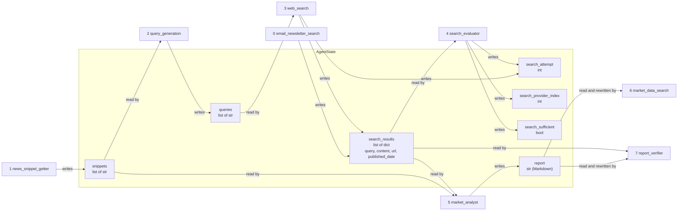

# Architecture

## Agent Harness

The Lambda runs an 8-node LangGraph pipeline (`_build_graph` in `lambda/agent.py`). Only 3 nodes call an LLM, and only 1 of those has tools; the rest are deterministic Python.

Each box below shows the node's **objective**, the **state keys it reads** (`in`), the **state keys it writes** (`out`), and its **tools**. Blue = LLM node, grey = deterministic node. Nodes with a tool-calling LLM are noted explicitly.

```mermaid
flowchart TD
    START([handler: initial state<br/>all keys empty / 0 / False])

    N0["<b>0. email_newsletter_search</b> · no LLM<br/>
    <b>Objective:</b> fetch recent newsletters; save as snippets and as citable sources<br/>
    <b>State in:</b> search_results<br/>
    <b>State out:</b> search_results (+ mailto: results)<br/>
    <b>Tools:</b> none (EmailProvider IMAP fetch, S3 put_object)<br/>
    <b>Side effect:</b> uploads snippets to sources/DATE/"]

    N1["<b>1. news_snippet_getter</b> · no LLM<br/>
    <b>Objective:</b> load all of today's snippets from S3 (single source of truth)<br/>
    <b>State in:</b> none<br/>
    <b>State out:</b> snippets (overwritten)<br/>
    <b>Tools:</b> none (S3 list + get)"]

    N2["<b>2. query_generation</b> · LLM, no tools<br/>
    <b>Objective:</b> turn snippets into 6-12 web search queries<br/>
    <b>Prompt data:</b> today, snippets_text<br/>
    <b>State in:</b> snippets<br/>
    <b>State out:</b> queries<br/>
    <b>Tools:</b> none"]

    N3["<b>3. web_search</b> · no LLM<br/>
    <b>Objective:</b> run all queries on the current provider; filter stale and future results<br/>
    <b>State in:</b> queries, search_provider_index, search_attempt, search_results<br/>
    <b>State out:</b> search_results (appended), search_attempt (+1)<br/>
    <b>Tools:</b> none (WebSearchProvider.search in a thread pool;<br/>attempt 0 = 1-day window, later = 7-day)"]

    N4{"<b>4. search_evaluator</b> · no LLM<br/>
    <b>Objective:</b> judge result quantity and domain diversity; advance provider if exhausted<br/>
    <b>State in:</b> search_results, search_provider_index, search_attempt<br/>
    <b>State out:</b> search_sufficient, search_provider_index, search_attempt<br/>
    <b>Tools:</b> none (ignores mailto: results)"}

    N5["<b>5. market_analyst</b> · LLM, no tools<br/>
    <b>Objective:</b> write the cited Markdown report<br/>
    <b>Prompt data:</b> today, snippets_text, context_text<br/>(each result: query, URL, age label via _age_label, content)<br/>
    <b>State in:</b> snippets, search_results<br/>
    <b>State out:</b> report<br/>
    <b>Tools:</b> none"]

    N6["<b>6. market_data_search</b> · LLM + tools<br/>
    <b>Objective:</b> add verified price and technical evidence next to asset claims<br/>
    <b>Prompt data:</b> today, report_md<br/>
    <b>State in:</b> report<br/>
    <b>State out:</b> report (evidence spans inserted at anchors)<br/>
    <b>Tools:</b> get_market_data(symbol)<br/>(yfinance + stockstats, up to MARKET_DATA_MAX_TOOL_CALLS loops)<br/>
    <b>Fails open:</b> bad JSON / anchor / symbol leaves report unchanged"]

    N7["<b>7. report_verifier</b> · no LLM<br/>
    <b>Objective:</b> deterministic backstop on citations, dates and priced-in checks<br/>
    <b>State in:</b> report, search_results<br/>
    <b>State out:</b> report (repaired / flagged)<br/>
    <b>Tools:</b> none"]

    END_NODE([END: handler renders PDF via WeasyPrint<br/>and uploads md + pdf to reports bucket])

    START --> N0 --> N1 --> N2 --> N3 --> N4
    N4 -- "insufficient and attempt less than 2<br/>(retry wide pass, or next provider)" --> N3
    N4 -- "sufficient, or attempt at least 2" --> N5
    N5 --> N6 --> N7 --> END_NODE

    classDef llm fill:#dbeafe,stroke:#2563eb,color:#111;
    classDef det fill:#f3f4f6,stroke:#6b7280,color:#111;
    classDef edge fill:#fff,stroke:#111,color:#111;
    class N2,N5,N6 llm;
    class N0,N1,N3,N4,N7 det;
    class START,END_NODE edge;
```

### Central state (`lambda/state.py`)

### Shared context for all LLM nodes

- **System prompt** (`lambda/prompts/system.j2`): rendered once with no variables. It sets the team role, the asset classes in scope, and a "fully automated, never ask for clarification" instruction. It is the `SystemMessage` for every LLM call.
- **Date**: `today_utc()` in `lambda/helpers.py`, which respects `INA_DATETIME_OVERRIDE`. Nodes read it directly rather than from state.
- **LLM instances**: `main_llm` for Query Generation and Market Analyst; `tool_llm` for Market Data Search (the same object as `main_llm` on OpenRouter).
- **Memory**: none across nodes or runs. Each call is a fresh system + human message pair. The only accumulated conversation is Market Data Search's tool loop, within that node.
