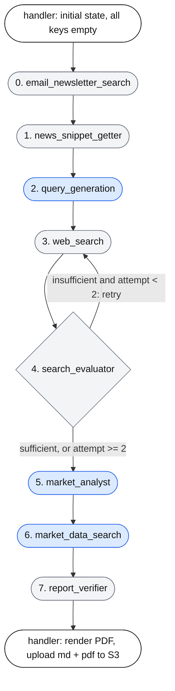
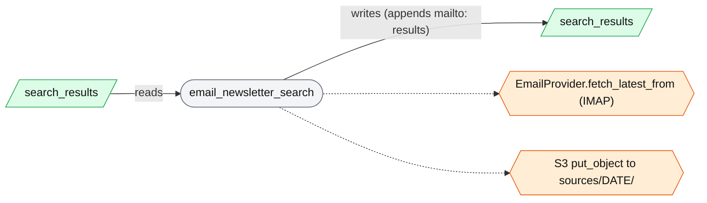
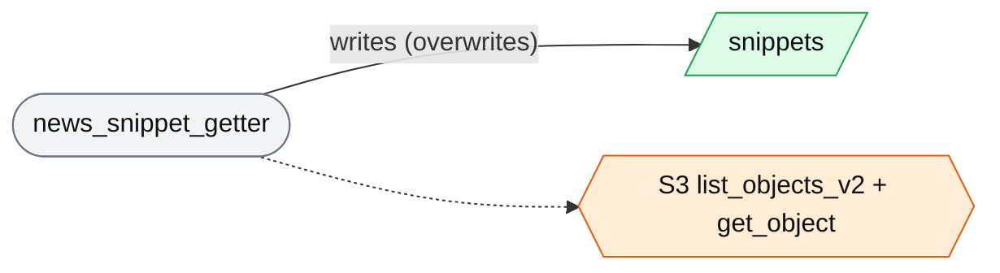
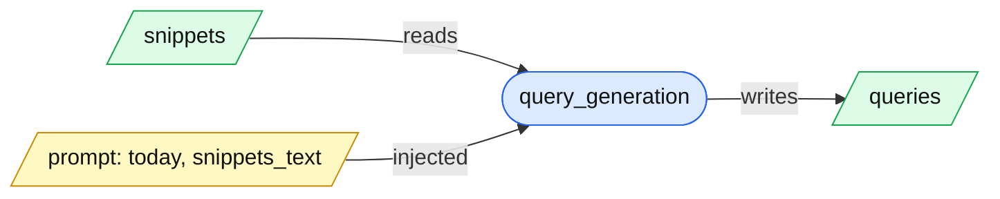
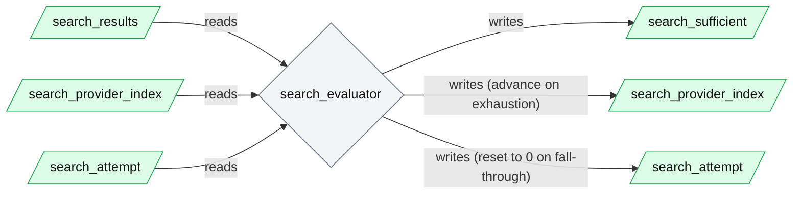
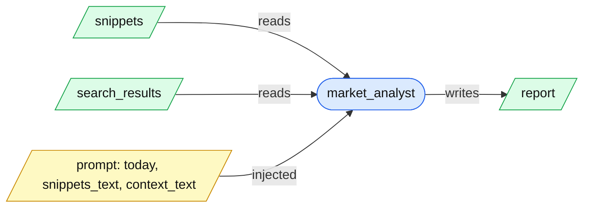
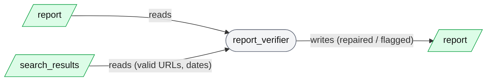

# Architecture

## Agent Harness

The Lambda runs an 8-node LangGraph pipeline (`_build_graph` in `lambda/agent.py`). Only 3 nodes call an LLM, and only 1 of those has tools; the rest are deterministic Python.

How to read the diagrams below: the overview shows the order of the nodes; each node then gets its own small diagram showing what it **reads** from the central state, what it **writes** back, the **prompt data** injected (LLM nodes), and the **tools / external calls** it makes.

**Legend**

### Pipeline overview

### Node 0: email_newsletter_search (no LLM)

Objective: fetch recent newsletters; save them as snippets and as citable sources.

### Node 1: news_snippet_getter (no LLM)

Objective: load all of today's snippets from S3, the single source of truth.

### Node 2: query_generation (LLM, no tools)

Objective: turn snippets into 6-12 web search queries.

### Node 3: web_search (no LLM)

Objective: run every query on the current provider; drop stale and future-dated results. Attempt 0 uses a 1-day window; later attempts use 7 days.

### Node 4: search_evaluator (no LLM)

Objective: judge result count and domain diversity (ignoring `mailto:` results); advance to the next provider when the current one is exhausted. Its output drives the conditional edge back to `web_search` or on to `market_analyst`.

### Node 5: market_analyst (LLM, no tools)

Objective: write the cited Markdown report. Each search result is rendered into `context_text` with its URL and an age label computed in code (`_age_label`).

### Node 6: market_data_search (LLM with tools)

Objective: add verified price and technical evidence next to asset claims. The model supplies only `{anchor, symbol, commentary}`; the price and indicator facts are inserted by code. It fails open: bad JSON, an unmatched anchor or an unfetched symbol leaves the report unchanged.

### Node 7: report_verifier (no LLM)

Objective: deterministic backstop. Unwraps backticked links, strips or repairs citations whose URL was not returned by search, corrects citation dates and STALE flags, and flags unquantified priced-in bullets.

### Central state: who reads and writes each key (`lambda/state.py`)

R = reads, W = writes (including append / overwrite). Empty = not touched.

| Node | snippets | queries | search_results | search_attempt | search_provider_index | search_sufficient | report |
|---|:-:|:-:|:-:|:-:|:-:|:-:|:-:|
| 0. email_newsletter_search | | | R, W | | | | |
| 1. news_snippet_getter | W | | | | | | |
| 2. query_generation | R | W | | | | | |
| 3. web_search | | R | R, W | R, W | R | | |
| 4. search_evaluator | | | R | R, W | R, W | W | |
| 5. market_analyst | R | | R | | | | W |
| 6. market_data_search | | | | | | | R, W |
| 7. report_verifier | | | R | | | | R, W |

`search_sufficient` is also read by the router `route_after_evaluation`, together with `search_attempt`.

### State item types and schemas

`AgentState` is a `TypedDict` (`lambda/state.py`) used as the `StateGraph` schema. A `TypedDict` is a static type hint only. LangGraph does not validate values at runtime, and the state has no reducers (no `Annotated[..., operator.add]`), so every key is last-write-wins. Nodes return `{**state, ...}`, so appends such as `search_results` are done manually by each node. No node is restricted to the keys it declares.

| Key | Declared type | Fixed schema? | Actual shape and who enforces it |
|---|---|---|---|
| `snippets` | `list[str]` | **No.** Free text. | Each item is the raw text of one S3 object, stripped. User-submitted snippets are validated only by the server's `SnippetRequest` (non-empty, max length). Newsletter snippets follow a de facto template from `_format_snippet`: `Source:`, `Subject:`, `Received:` lines, a blank line, then the body. Downstream nodes only join them with `---`, so neither format is parsed. |
| `queries` | `list[str]` | **No.** | The LLM's output split on lines, with leading numbering stripped. The prompt asks for 6-12 queries, but the count and content are not checked. |
| `search_results` | `list[dict]` | **De facto only**, via convention. The dict keys are not declared anywhere. | Web results are built in `web_search.py` and newsletter results in `email_newsletter_search._as_search_result`. Both produce `{query: str, content: str, url: str, published_date: str}`. See the field notes below. |
| `search_attempt` | `int` | Yes (a primitive). | 0 or more. Incremented by `web_search`, reset to 0 by `search_evaluator` on provider fall-through. Routing treats `>= 2` as exhausted. |
| `search_provider_index` | `int` | Yes (a primitive). | Index into the provider list. Only `search_evaluator` advances it. It is never bounds-checked beyond that node's `provider_index + 1 < len(providers)` guard. |
| `search_sufficient` | `bool` | Yes (a primitive). | Set by `search_evaluator` and read only by `route_after_evaluation`. |
| `report` | `str` | **No.** Markdown prose. | Structure is requested by the `market_analyst.j2` prompt (seven numbered `##` sections). It is not validated. `market_data_search` appends raw HTML `` blocks into it. `report_verifier` regex-matches headings and fails open if they are missing. |

**`search_results` field notes**

- `url`: an `http(s)` URL for web results, or `mailto:<sender>#<ISO timestamp>` for newsletters. The `mailto:` prefix is how nodes tell the two apart (`_is_newsletter_result`).
- `published_date`: a string in one of three forms: ISO 8601 (web results with a date, and newsletters), RFC 2822 (some providers), or an empty string when unknown. `parse_source_date` handles all three. Unknown dates are kept and flagged, not dropped.
- `content`: free text, either a provider's article extract or the newsletter body.
- `query`: the originating search query, or `Email newsletter: <subject>` for newsletters.
- Results are read with a mix of `r["url"]`, `r["query"]`, `r["content"]` (assumed present) and `r.get("published_date", "")`, so a missing key would raise a `KeyError` in some places and be tolerated in others.

**Schemas that do exist at the edges.** There are typed objects around the graph, but none of them are the state itself:

- `EmailMessage` dataclass (`sender`, `subject`, `received_at`, `body`) in `email_providers/base.py`.
- `SnippetRequest` Pydantic model on the server's `POST /snippets`.
- `WebSearchProvider.search` contract, documented as `{"results": [{url, content, published_date}]}` or `{"error": Exception}`, in `search_providers/base.py` (docstring only, not enforced).
- The `{anchor, symbol, commentary}` JSON the Market Data Search LLM must return, filtered by `_extract_insertions` (checks the keys exist, not their types).

### Shared context for all LLM nodes

- **System prompt** (`lambda/prompts/system.j2`): rendered once with no variables. It sets the team role, the asset classes in scope, and a "fully automated, never ask for clarification" instruction. It is the `SystemMessage` for every LLM call.
- **Date**: `today_utc()` in `lambda/helpers.py`, which respects `INA_DATETIME_OVERRIDE`. Nodes read it directly rather than from state.
- **LLM instances**: `main_llm` for Query Generation and Market Analyst; `tool_llm` for Market Data Search (the same object as `main_llm` on OpenRouter).
- **Memory**: none across nodes or runs. Each call is a fresh system + human message pair. The only accumulated conversation is Market Data Search's tool loop, within that node.
