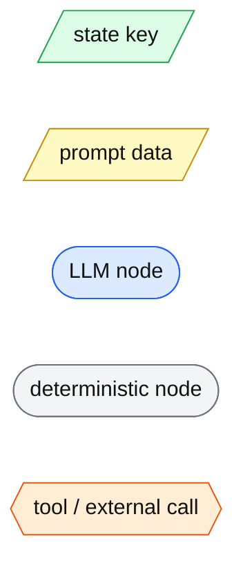
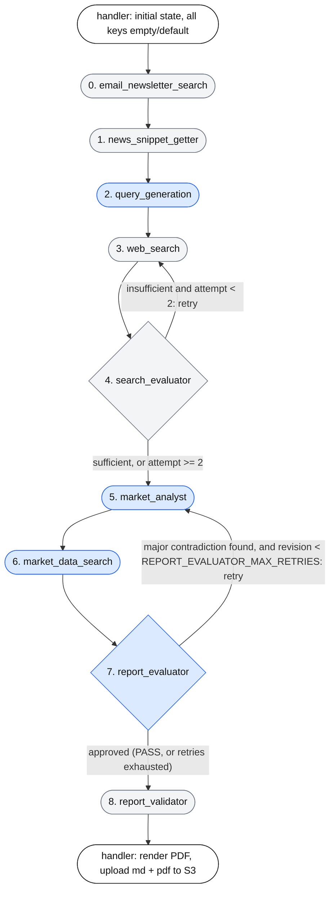
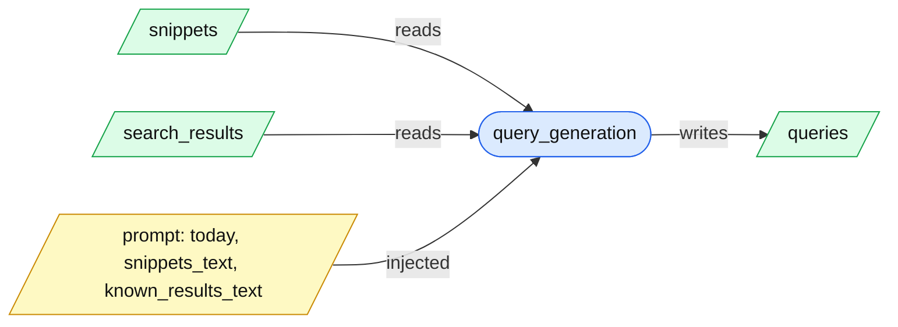
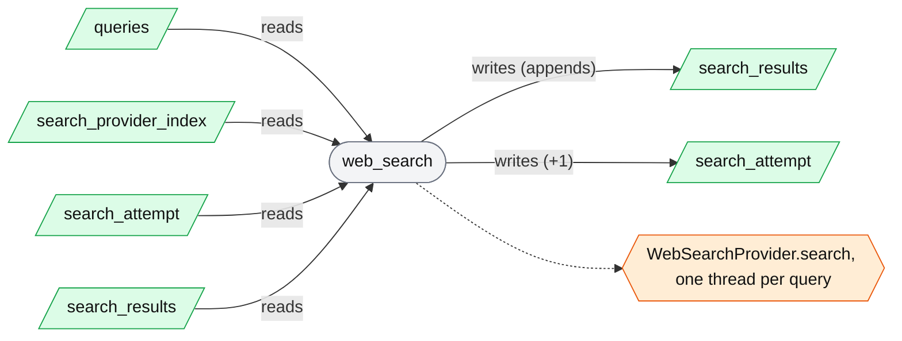
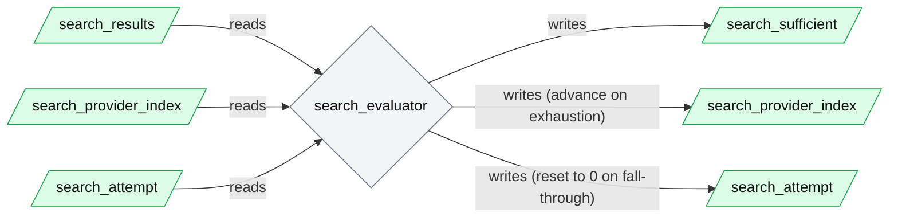
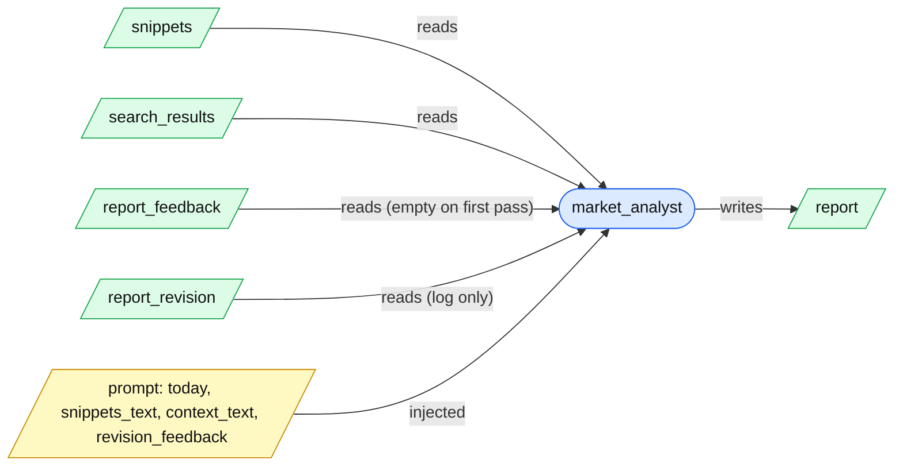
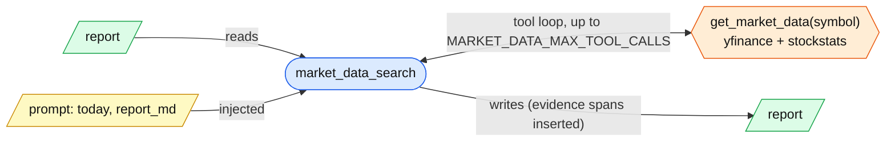
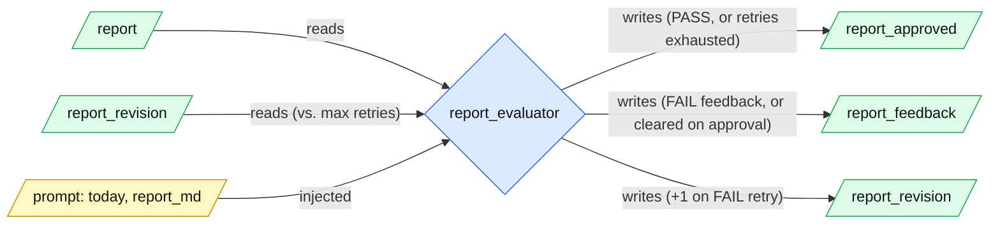
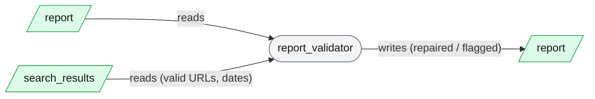

# Architecture

## Agent Harness

The Lambda runs a 9-node LangGraph pipeline (`_build_graph` in `lambda/agent.py`). 4 nodes call an LLM, and only 1 of those has tools; the rest are deterministic Python.

How to read the diagrams below: the overview shows the order of the nodes; each node then gets its own small diagram showing what it **reads** from the central state, what it **writes** back, the **prompt data** injected (LLM nodes), and the **tools / external calls** it makes.

**Legend**

### Pipeline overview

### Node 0: email_newsletter_search (no LLM)

Objective: fetch recent newsletters; save them as snippets and as citable sources.

### Node 1: news_snippet_getter (no LLM)

Objective: load all of today's snippets from S3, the single source of truth.

### Node 2: query_generation (LLM, no tools)

Objective: turn snippets, plus whatever `search_results` already holds at this point in the graph (newsletter entries from Node 0 — `web_search` hasn't run yet), into 6-12 web search queries. The prompt lists those existing results under an ALREADY KNOWN section and instructs the model to target gaps and follow-ups rather than writing a query that would just resurface information already sitting there.

### Node 3: web_search (no LLM)

Objective: run every query on the current provider; drop stale and future-dated results. Attempt 0 uses a 1-day window; later attempts use 7 days. Each result is validated into a `SearchResult` (see schema section below) before being appended — a provider field reported as `None` (e.g. Tavily's `published_date`) is normalized to `""` first, since the schema requires a `str`.

### Node 4: search_evaluator (no LLM)

Objective: judge result count and domain diversity (ignoring `mailto:` results); advance to the next provider when the current one is exhausted. Its output drives the conditional edge back to `web_search` or on to `market_analyst`.

### Node 5: market_analyst (LLM, no tools)

Objective: write the cited Markdown report. Each search result is rendered into `context_text` with its URL and an age label computed in code (`_age_label`). On a retry from Report Evaluator (Node 7), `report_feedback` is non-empty; the prompt prepends a REVISION REQUIRED block quoting it and instructs the model to write a fresh draft from scratch that resolves it, rather than patching the previous one. `report_revision` is read only for the diagnostic log line, not injected into the prompt.

### Node 6: market_data_search (LLM with tools)

Objective: add verified price and technical evidence next to asset claims. The model supplies only `{anchor, symbol, commentary}`; the price and indicator facts are inserted by code. It fails open: bad JSON, an unmatched anchor or an unfetched symbol leaves the report unchanged. This node re-runs every time Market Analyst re-runs (see Node 7's retry loop), each time against whatever the latest draft is — it clears its per-run snapshot cache at the start of every invocation for exactly this reason.

### Node 7: report_evaluator (LLM, no tools)

Objective: scan the drafted report for major **internal contradictions only** — e.g. an Opportunities pick resting on an assumption a different section's Key Themes explicitly contradicts. It does not re-derive the analysis or re-check citations/sources; that is Report Validator's job (Node 8). It must respond `VERDICT: PASS` or `VERDICT: FAIL` plus a `FEEDBACK:` paragraph. On `FAIL` (while `report_revision < REPORT_EVALUATOR_MAX_RETRIES`, default `2`), it sets `report_approved = False`, `report_feedback` to that paragraph, increments `report_revision`, and the conditional edge routes back to `market_analyst`. On `PASS`, or once retries are exhausted, it sets `report_approved = True` and clears `report_feedback`, and the graph proceeds to `report_validator`. An unparseable LLM response fails open as `PASS`, so a malformed judge response cannot loop the graph forever.

### Node 8: report_validator (no LLM)

Renamed from `report_verifier`. Objective: deterministic backstop, run only once Report Evaluator has signed off. Unwraps backticked links, strips or repairs citations whose URL was not returned by search, corrects citation dates and STALE flags, and flags unquantified priced-in bullets.

### Central state: who reads and writes each key (`lambda/state.py`)

R = reads, W = writes (including append / overwrite). Empty = not touched.

| Node | snippets | queries | search_results | search_attempt | search_provider_index | search_sufficient | report | report_feedback | report_revision | report_approved |
|---|:-:|:-:|:-:|:-:|:-:|:-:|:-:|:-:|:-:|:-:|
| 0. email_newsletter_search | | | R, W | | | | | | | |
| 1. news_snippet_getter | W | | | | | | | | | |
| 2. query_generation | R | W | R | | | | | | | |
| 3. web_search | | R | R, W | R, W | R | | | | | |
| 4. search_evaluator | | | R | R, W | R, W | W | | | | |
| 5. market_analyst | R | | R | | | | W | R | R | |
| 6. market_data_search | | | | | | | R, W | | | |
| 7. report_evaluator | | | | | | | R | W | R, W | W |
| 8. report_validator | | | R | | | | R, W | | | |

`search_sufficient` is also read by the router `route_after_evaluation`, together with `search_attempt`. `report_approved` is likewise read by the router `route_after_report_evaluation`.

### State item types and schemas

`AgentState` is a **Pydantic `BaseModel`** (`lambda/state.py`), not a `TypedDict` — this changed from an earlier version of this pipeline that used an unvalidated `TypedDict`. LangGraph coerces the accumulated channel dict into `AgentState` (`AgentState(**channel_values)`) before every node runs, so a malformed update is caught — as a `pydantic.ValidationError` — at the point it would otherwise silently enter state, not however many nodes downstream it eventually breaks something. There are still no reducers (no `Annotated[..., operator.add]`), so every key is last-write-wins; nodes return a **minimal partial dict** of only the keys they change (e.g. `{"report": report_md}`), not `{**state, ...}` — LangGraph merges that into the per-key channels. Manual accumulation (e.g. `state.search_results + new_results`) is still how append-style fields are built, since there's no `add` reducer. No node is restricted to the keys it declares in its own signature — any node can still read or write any key on `AgentState`.

| Key | Declared type | Fixed schema? | Actual shape and who enforces it |
|---|---|---|---|
| `snippets` | `list[str]` | **No.** Free text. | Each item is the raw text of one S3 object, stripped. User-submitted snippets are validated only by the server's `SnippetRequest` (non-empty, max length). Newsletter snippets follow a de facto template from `_format_snippet`: `Source:`, `Subject:`, `Received:` lines, a blank line, then the body. Downstream nodes only join them with `---`, so neither format is parsed. |
| `queries` | `list[str]` | **No.** | The LLM's output split on lines, with leading numbering stripped. The prompt asks for 6-12 queries, but the count and content are not checked. |
| `search_results` | `list[SearchResult]` | **Yes.** `SearchResult` (also `lambda/state.py`) declares `query: str = ""`, `content: str = ""`, `url: str = ""`, `published_date: str = ""` — all plain, non-optional strings with empty-string defaults. | Web results (`web_search.py`) and newsletter results (`email_newsletter_search._as_search_result`) both construct a `SearchResult` instance directly, so a missing or wrong-typed field raises immediately at the point it's produced. LangGraph re-validates the whole list on every node's entry regardless (a node may return plain dicts as a partial update; these are validated into `SearchResult` the next time `AgentState` is reconstructed), so an item can never reach a downstream node unvalidated. One real provider quirk this schema surfaced: Tavily can return `published_date: None` explicitly even on `topic="news"` — not an omitted key, an explicit `None` — which fails `SearchResult`'s `str` field. `web_search.py` normalizes every string field with `r.get(key) or ""` before construction specifically to absorb this. |
| `search_attempt` | `int` | Yes (a primitive). | 0 or more. Incremented by `web_search`, reset to 0 by `search_evaluator` on provider fall-through. Routing treats `>= 2` as exhausted. |
| `search_provider_index` | `int` | Yes (a primitive). | Index into the provider list. Only `search_evaluator` advances it. It is never bounds-checked beyond that node's `provider_index + 1 < len(providers)` guard. |
| `search_sufficient` | `bool` | Yes (a primitive). | Set by `search_evaluator` and read only by `route_after_evaluation`. |
| `report` | `str` | **No.** Markdown prose. | Structure is requested by the `market_analyst.j2` prompt (seven numbered `##` sections). It is not validated. `market_data_search` appends raw HTML `` blocks into it. `report_validator` regex-matches headings and fails open if they are missing. Regenerated from scratch by `market_analyst` on every Report Evaluator-triggered retry, not patched in place. |
| `report_feedback` | `str` | Yes (a primitive). | `""` until Report Evaluator's first `FAIL`. Set to its `FEEDBACK:` paragraph on `FAIL`; read by `market_analyst`'s prompt on the next pass; cleared back to `""` once Report Evaluator approves. |
| `report_revision` | `int` | Yes (a primitive). | 0 until the first retry. Incremented by `report_evaluator` on each `FAIL` that triggers a retry; compared against `REPORT_EVALUATOR_MAX_RETRIES` (default `2`) to decide whether to retry again or proceed anyway. |
| `report_approved` | `bool` | Yes (a primitive). | Set by `report_evaluator`; read only by `route_after_report_evaluation`, the conditional edge back to `market_analyst` or on to `report_validator`. |

**`search_results` field notes**

- `url`: an `http(s)` URL for web results, or `mailto:<sender>#<ISO timestamp>` for newsletters. The `mailto:` prefix is how nodes tell the two apart (`_is_newsletter_result`).
- `published_date`: a string in one of three forms: ISO 8601 (web results with a date, and newsletters), RFC 2822 (some providers), or an empty string when unknown. `parse_source_date` handles all three. Unknown dates are kept and flagged, not dropped. Never `None` by the time it reaches a `SearchResult` — see the provider-quirk note above.
- `content`: free text, either a provider's article extract or the newsletter body.
- `query`: the originating search query, or `Email newsletter: <subject>` for newsletters.
- Results are read with plain attribute access (`r.query`, `r.content`, `r.url`, `r.published_date`) now that the field set is fixed by `SearchResult` — there is no `KeyError`/`.get()` split between "assumed present" and "tolerated missing" fields the way there would be on a raw dict, since every field always exists (defaulting to `""` if unset).

**Schemas that do exist at the edges, beyond the state itself:**

- `EmailMessage` dataclass (`sender`, `subject`, `received_at`, `body`) in `email_providers/base.py`.
- `SnippetRequest` Pydantic model on the server's `POST /snippets`.
- `WebSearchProvider.search` contract, documented as `{"results": [{url, content, published_date}]}` or `{"error": Exception}`, in `search_providers/base.py` (docstring only, not enforced) — this is the untyped boundary `web_search.py` normalizes before constructing a `SearchResult`.
- The `{anchor, symbol, commentary}` JSON the Market Data Search LLM must return, filtered by `_extract_insertions` (checks the keys exist, not their types) — still not Pydantic-enforced.
- The `VERDICT: PASS|FAIL` / `FEEDBACK: ...` text contract the Report Evaluator LLM must return, parsed by regex (`_VERDICT_RE`, `_FEEDBACK_RE`) — also not Pydantic-enforced; an unparseable response fails open as `PASS` rather than raising.

### Shared context for all LLM nodes

- **System prompt** (`lambda/prompts/system.j2`): rendered once with no variables. It sets the team role, the asset classes in scope, and a "fully automated, never ask for clarification" instruction. It is the `SystemMessage` for every LLM call.
- **Date**: `today_utc()` in `lambda/helpers.py`, which respects `INA_DATETIME_OVERRIDE`. Nodes read it directly rather than from state.
- **LLM instances**: `main_llm` for Query Generation, Market Analyst, and Report Evaluator; `tool_llm` for Market Data Search (the same object as `main_llm` on OpenRouter).
- **Memory**: none across nodes or runs. Each call is a fresh system + human message pair. The only accumulated conversation is Market Data Search's tool loop, within that node. A Report Evaluator-triggered retry does not carry the rejected draft forward as conversation history either — `market_analyst` gets a fresh system + human message pair each time, with the feedback injected as prompt text, not as prior turns.
